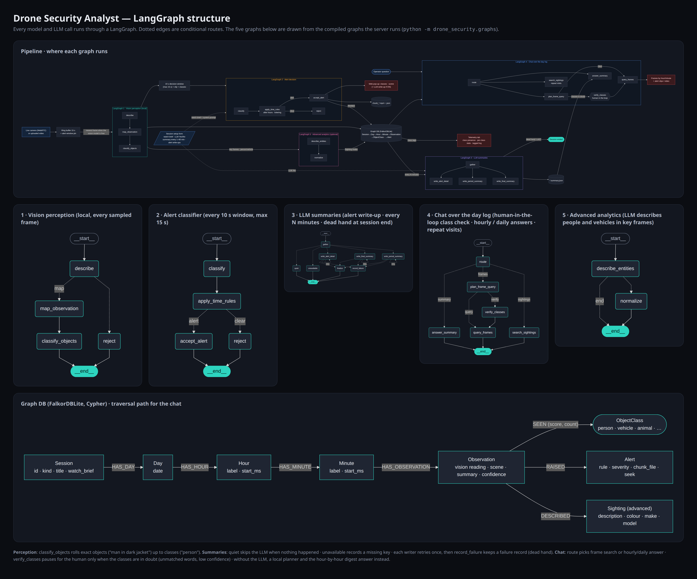
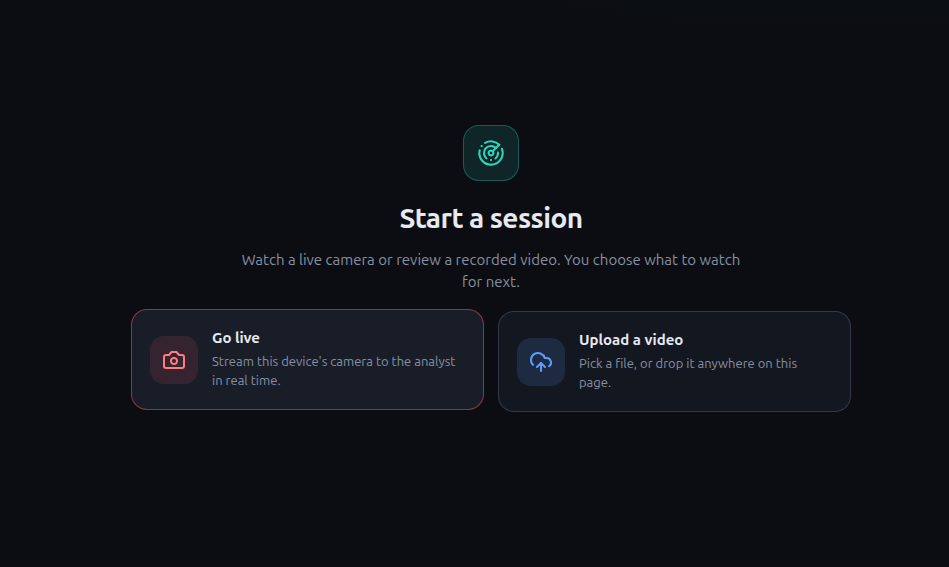
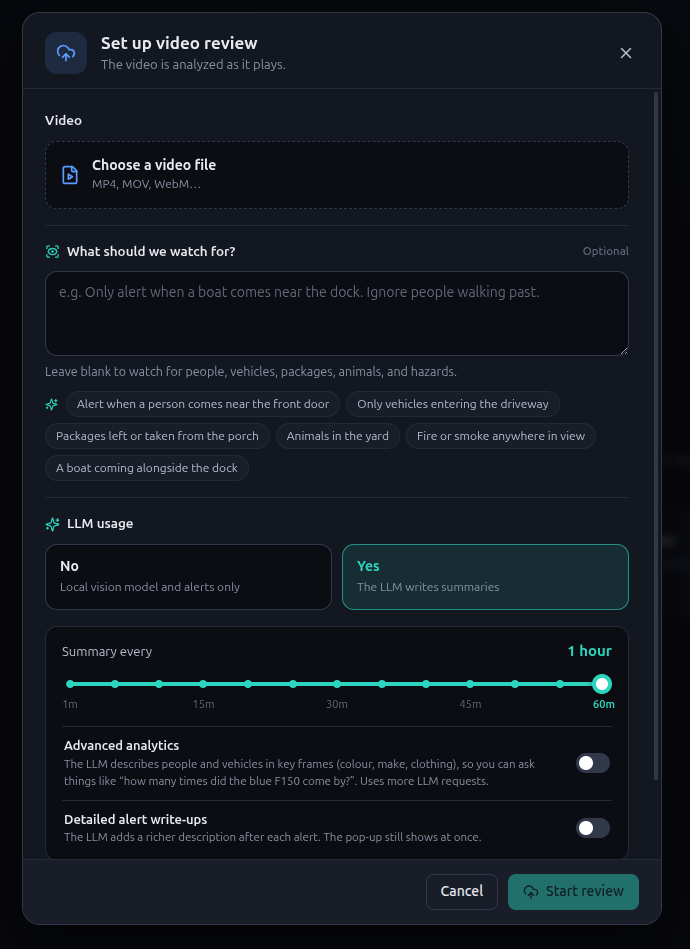

# Drone Security Analyst

An on-site security analyst for a docked drone that watches one property. It takes a live camera feed or an uploaded video, describes what it sees with a local vision model, decides when something deserves an alert, keeps the video evidence, writes timestamped summaries, and answers questions about the day.

<!-- ASSET: demo video (link or embedded player) -->

<!-- ASSET: hero screenshot — a live session with an alert pop-up -->

## What it does

- **Watches live or uploaded video.** It takes a browser camera over WebRTC or a video file, through the same pipeline.
- **Describes every moment it can.** A local vision model reads the newest frame continuously. Objects are rolled up to classes (person, vehicle, animal, package, hazard, …) with the scene as location. Every reading goes to an hourly JSON log.
- **Decides alerts on short windows.** Every 10 s (never more than 15), an alert classifier judges a short clip plus the readings against the session's **watch brief**. Two predefined rules add **after hours** (person or vehicle at night) and **loitering** (a person in view 60 s or more).
- **Alerts at once, with proof.** A pop-up appears immediately, and a clip from 8 s before to 2 s after the detection is saved with a JSON file holding the seek offset.
- **Summarizes, with evidence.** When LLM usage is on, the LLM writes a summary every N minutes and a **dead-hand** final summary as the last work of the session. Summaries cite timestamps and clips and look at a few key frames, never full video.
- **Remembers.** Every reading is indexed in an embedded graph database (session → day → hour → minute → reading, with class and alert edges).
- **Answers questions.** The chat handles requests like "show all vehicle events between 14:00 and 15:00" and "summarize each hour". When a word does not map cleanly to a class, it asks you to confirm the classes first.
- **Tracks repeat visitors (optional).** With advanced analytics on, the LLM describes people and vehicles (colour, make, clothing), so "how many times did the blue Ford F150 come by?" gets each visit with its clips.
- **Shows telemetry and cost.** The telemetry tab shows per-class activity from the class tags. The Cost button shows requests, tokens, and spend for the session.

<!-- ASSET: screenshot — chat answering a time/class question -->
<!-- ASSET: screenshot — telemetry tab -->
<!-- ASSET: screenshot — cost panel -->

## How it works

```
Live camera / uploaded video
  → ring buffer (15 s, in memory)
  → local vision model on the newest frame → classes + scene → hourly log + graph index
  → every 10 s (max 15 s): clip + readings → alert classifier + time rules
  → alert: pop-up · saved clip (8 s + 2 s) · optional LLM write-up
  → LLM summary every N minutes · dead-hand final summary at the end
```

Every model call runs through a LangGraph:



More detail:
- [docs/user-guide.md](docs/user-guide.md): every screen and option, explained
- [docs/architecture.md](docs/architecture.md): components, data flow, storage, privacy
- [docs/design-decisions.md](docs/design-decisions.md): why it is built this way, and the alternatives weighed
- [docs/testing.md](docs/testing.md): test strategy and coverage
- [FEATURES.md](FEATURES.md): the feature checklist

## Run it

You need:
- Python 3.12+ with [uv](https://docs.astral.sh/uv/)
- Node 22.12+ (`nvm install 22`)
- a Google AI Studio API key for the alert classifier and the LLM

```bash
cp .env.example .env          # then set GOOGLE_API_KEY
uv sync
cd web && npm install && npm run build && cd ..
uv run python main.py         # http://127.0.0.1:8000
```

The vision-model weights are downloaded into `models/vision/` on first start. The camera works on `localhost` and `127.0.0.1`; any other host needs HTTPS.

Without an API key the app still runs: readings stream, the time rules still alert, and clips can be saved by hand.

For frontend work, keep the backend running and start Vite in a second terminal:

```bash
cd web && npm run dev         # http://localhost:5173, proxies /api to :8000
```

## Using it

**1. Start a session.** Stream this device's camera (**Go live**), or review a recorded file (**Upload a video**). Both go through the same pipeline.



**2. Set it up.** Before anything runs, choose what this session should do:



| Setting | What it offers |
|---------|----------------|
| **What should we watch for?** | A plain-language watch brief that becomes the alert classifier's instructions, with one-click examples. Leave it blank for people, vehicles, packages, animals, and hazards. |
| **LLM usage: No / Yes** | *No*: local vision model and alerts only, with no LLM calls. *Yes*: the LLM also writes summaries. |
| **Summary every** | How often the LLM writes a timestamped summary (1 minute, then every 5 up to 60). A final summary is always written when the session ends. |
| **Advanced analytics** | The LLM describes people and vehicles (colour, make, clothing), so the chat can count repeat visits: "how many times did the blue F150 come by?" |
| **Detailed alert write-ups** | A richer LLM description after each alert. The pop-up never waits for it. |

**3. Watch and ask.** Readings and alerts arrive live, and each alert plays its saved clip. Use **Ask** to query the log, **Telemetry** for class activity, and **Cost** for what the session used.

The full walkthrough, option by option: [docs/user-guide.md](docs/user-guide.md).

## Configuration

Set these in `.env` (copy `.env.example`). Never commit `.env`.

| Variable | Purpose | Default |
|----------|---------|---------|
| `GOOGLE_API_KEY` | Google AI Studio key for the alert classifier and the LLM | — |
| `DRONE_DECISION_MODEL` | Alert classifier model | set in `config.py` |
| `DRONE_SUMMARY_MODEL` | LLM for summaries, alert write-ups, and advanced analytics. A comma-separated list makes a fallback chain | set in `config.py` |
| `DRONE_CHAT_MODEL` | LLM for the chat. Same chain format | set in `config.py` |
| `DRONE_AFTER_HOURS` | After-hours window for the after-hours rule; empty turns it off | `22:00-06:00` |
| `DRONE_LOITER_SECONDS` | Continuous time in view that counts as loitering | `60` |
| `DRONE_DATA_DIR` | Sessions, clips, logs, and databases | `./data` |
| `DRONE_VISION_DIR` | Vision-model weights | `models/vision` |
| `DRONE_ICE_SERVERS` | Comma-separated STUN/TURN URLs when the camera is on another machine | none |

## Tests

```bash
uv run pytest -q                       # 206 backend tests
cd web && npm test && npm run build    # 64 frontend tests, typecheck, build
```

No API key, GPU, or camera is needed: models are replaced by fakes and test videos are generated. The brief's own examples ("alert triggered at midnight", "person loitering", "truck logged correctly", "blue Ford F150 entered twice") are named tests. See [docs/testing.md](docs/testing.md).

## Project layout

```
main.py                  FastAPI app; each route calls one SessionManager method
src/drone_security/
  ingest/                WebRTC track, video reader, ring buffer
  perception/            vision-model adapter, classes, perception graph
  decisions/             alert graph and time rules
  pipeline/              sessions, sampling, windows, presence, summaries, events
  agent/                 LLM graphs (summaries, chat, entity descriptions), metering
  indexing/              SQLite, graph index, logs, clips, key frames, usage ledger
  telemetry/             class activity report
  models/                typed data models
web/                     React + Vite + TypeScript UI
tests/                   pytest suite
docs/                    architecture, design decisions, testing, code inventory
```

## How AI tools were used

The project was built with AI coding assistants inside a fixed engineering loop.

- **Cursor** held the project's rules and skill (`.cursor/`): the pipeline contract, coding standards, and a definition of done. These made every change follow the same loop: survey the code inventory, implement typed classes, update the inventory, write tests, get them passing, run a smoke test.
- **Claude Code** used the same skill (`CLAUDE.md`, `AGENTS.md`, `.claude/`). It handled most of the implementation, refactors, tests, and documentation, including browser screenshots to check the UI on desktop and phone sizes.
- **What worked:** writing the rules down once. A typed-model-first codebase plus `docs/code-inventory.md` let the assistant extend existing classes instead of inventing parallel ones. The test gate caught regressions from large refactors, such as renaming every model reference to a role name across 50+ files.
- **What needed a human:** product calls, such as dropping simulated flight telemetry because it contradicted the video, making LLM features opt-in per session, and choosing which brief examples to turn into tests. Prices and rate limits were checked against the provider's pages rather than taken from memory.

## Limitations

- Drone position and altitude are not modelled; telemetry is derived from what the camera sees. See [design decision 12](docs/design-decisions.md#12-telemetry-from-class-tags-not-simulated-flight-data).
- Short clips and a few still frames go to hosted models, so this is hybrid, not air-gapped.
- Repeat-visit counting matches descriptions; two identical vehicles count as one.
- Paused chat questions are lost when the server restarts.
