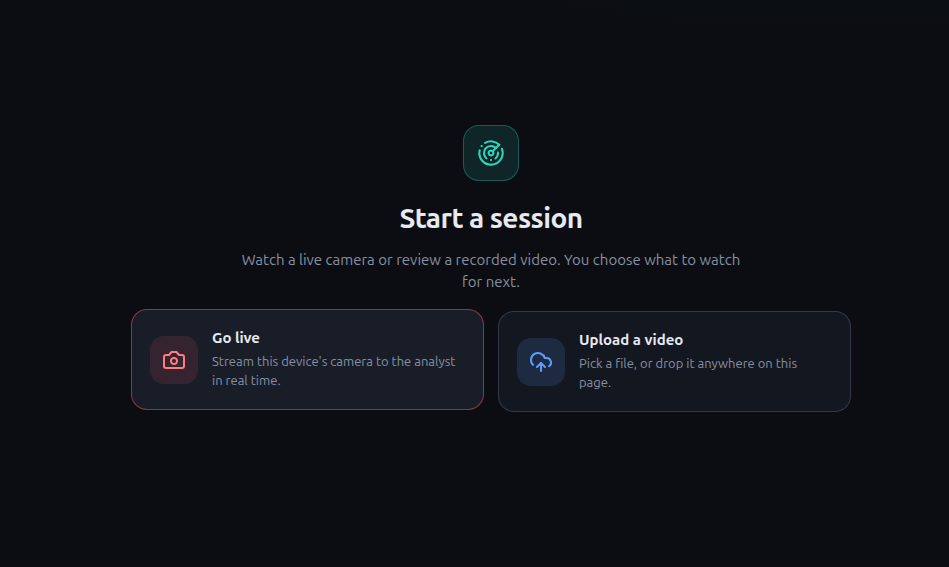
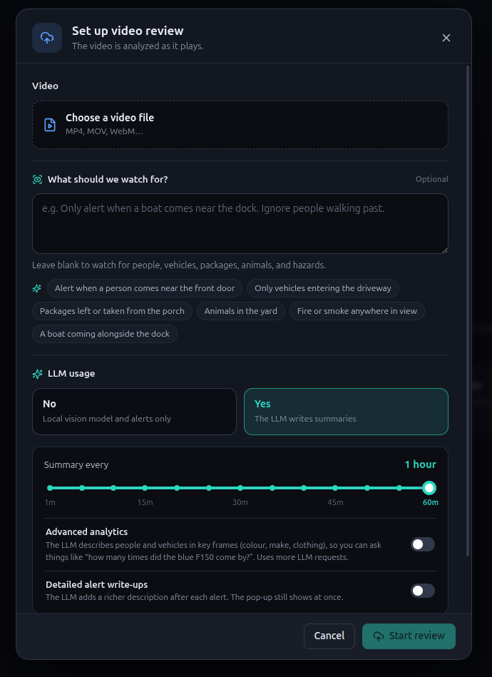

# User guide

What the operator sees, screen by screen, and what each option does.

## 1. Start a session

Every session begins here. There are two ways in, and both go through the same pipeline: buffering, local vision model, alert decisions, clips, and summaries.

| Option | What it does |
|--------|--------------|
| **Go live** | Streams this device's camera to the analyst in real time over WebRTC. The browser asks for camera permission. The camera works on `localhost`; any other host needs HTTPS. |
| **Upload a video** | Reviews a recorded file. Pick a file, or drop one anywhere on the page. It is analyzed as it plays, in real time, as if it were a live feed. |

Past sessions are listed in the sidebar, grouped by day. Opening one shows its readings, alerts, clips, and summaries.

## 2. Set up the session

Either option opens a setup form before anything runs. Everything chosen here is stored with the session and cannot change mid-session, so each session's results match its settings. The live form is the same, without the file picker, and its button reads **Start live session**.

### Video (uploads only)

Choose the file to review: MP4, MOV, WebM, or any format the browser accepts as video.

### What should we watch for? (optional)

The **watch brief**: plain-language instructions for what deserves an alert. It becomes the alert classifier's system prompt for this session, so the same system can guard a front door, a driveway, or a dock.

- **Left blank**, it watches for people, vehicles, packages, animals, and hazards.
- **Examples** under the box fill it in with one click:
  - Alert when a person comes near the front door
  - Only vehicles entering the driveway
  - Packages left or taken from the porch
  - Animals in the yard
  - Fire or smoke anywhere in view
  - A boat coming alongside the dock
- The brief also scopes the built-in **time rules**. With a boats-only brief, a person at midnight does not trigger the after-hours alert.

### LLM usage

Whether this session may use the hosted language model.

| Choice | What happens |
|--------|--------------|
| **No** | The local vision model and alerts only. Every reading is still logged and indexed, the alert classifier still decides alerts, the time rules still fire, clips are still saved, and the chat still answers with a local planner. No LLM calls are made. |
| **Yes** | The LLM also writes summaries, and the options below become available. |

### Summary every (LLM on)

How often the LLM writes a **period summary**: 1 minute, then every 5 minutes up to 60. A short demo clip suits 1 minute; an overnight watch suits 1 hour.

- Each summary covers that period's readings and alerts, cites timestamps and clips, and looks at a few key frames (never full video).
- When the session ends, a **final summary** of the whole session is always written as the last step. If it fails, it retries once and then records the failure.

### Advanced analytics (LLM on, default off)

The LLM looks at key frames showing people, vehicles, animals, or packages, and describes each one: colour, make, model, kind, and clothing. Matching descriptions are grouped, and sightings more than 2 minutes apart count as separate visits, so the chat can answer:

- "How many times did the blue F150 come by?" → *seen twice (14:02–14:03, 16:40)*, with clips
- "Was the man in the red jacket here again?"

The descriptions also appear in the telemetry log. This option uses more LLM requests, which is why it is off by default.

### Detailed alert write-ups (LLM on, default off)

After each alert, the LLM writes a richer description of what happened, using the alert's frames. The alert pop-up still appears at once; the write-up is added to it when ready.

### Start

**Start review** (upload) or **Start live session** begins the analysis. **Cancel** returns to the start screen.

## 3. During and after the session

<!-- ASSET: screenshot — a session with readings and an alert pop-up -->

- **Readings:** each vision-model reading appears with its classes (person, vehicle, …) and the scene, and is overlaid on the video.
- **Alerts:** a pop-up appears as soon as a window is judged an alert, from the classifier or a time rule. It shows the rule, the severity, and what was seen. Opening it plays the saved clip, from 8 s before to 2 s after the detection.
- **Summaries tab:** period summaries and the final summary, with the key frames the LLM saw and links to the evidence clips.
- **Telemetry tab:** for each class, when it was in view, how often, and how strongly, plus a log of every tagged reading that you can filter by class.

<!-- ASSET: screenshot — chat answering a time/class question -->

- **Ask:** a chat over the session's log.
  - "Show all vehicle events between 14:00 and 15:00"
  - "Summarize each hour"
  - "How many times did the white van come by?" (advanced analytics)

  When a word does not map cleanly to a class, it asks you to confirm the classes before searching.

<!-- ASSET: screenshot — cost panel -->

- **Cost:** beside Ask. It shows the session's model requests and tokens by job (alert classifier, summaries, chat, advanced analytics), the cost at paid-tier prices, and how much of each model's free daily limit is used today.
- **Save clip:** saves a clip of the current moment by hand at any time.
